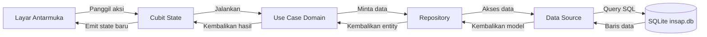

# Insap: Yuk Sadar Boncos

Aplikasi pencatat keuangan pribadi berbasis AI untuk mahasiswa.

## Tim Pengembang

| Nama | NIM | Peran |
|---|---|---|
| Rahmat Riyadi | 2409106074 | Project Manager, pemegang fondasi |
| Muh Ghazy Daffa Sampe | 2309106063 | Pemegang fitur |
| Luthfi Farros Athailah | 2309106073 | Pemegang fitur |

Mata kuliah Pemrograman Piranti Bergerak, Informatika, Universitas Mulawarman.

## Tentang Aplikasi

Insap adalah aplikasi pencatat keuangan pribadi yang dirancang khusus untuk mahasiswa dengan mengadaptasi metode refleksi Kakeibo. Insap berfokus pada pembentukan kebiasaan sadar finansial secara bertahap dan menempatkan pengguna sebagai pengendali utama keuangannya.

### Masalah yang Diselesaikan

1. Pengeluaran mahasiswa didominasi oleh transaksi bernominal kecil tetapi frekuensinya sering (jajan daring, transportasi, top up game, dan patungan kos) sehingga sulit diingat pada akhir bulan.
2. Proses pencatatan manual terasa merepotkan dan melelahkan, membuat kebiasaan mencatat sering terhenti hanya dalam beberapa hari.
3. Aplikasi keuangan yang tersedia di pasaran umumnya hanya berfokus pada rekapitulasi angka tanpa membantu mendorong perubahan perilaku nyata penggunanya.
4. Aplikasi sejenis kebanyakan berbahasa Inggris atau bernuansa korporat, tidak menggunakan kategori maupun gaya bahasa yang dekat dengan keseharian mahasiswa Indonesia.

### Sasaran Pengguna

- **Target utama:** Mahasiswa (rentang usia 18 sampai 25 tahun), baik mahasiswa yang menerima uang kiriman bulanan dari orang tua maupun mahasiswa indekos yang memiliki penghasilan tambahan dan mengelola pengeluaran bersama atau patungan.
- **Bukan target pengguna:** Pelaku usaha yang membutuhkan sistem akuntansi ganda atau perpajakan, karyawan yang memerlukan sistem penggantian biaya kantor (reimbursement), serta pengguna yang menginginkan integrasi otomatis dengan rekening perbankan.

## Cara Kerja Aplikasi

### Alur Pengguna

1. **Perkenalan (F-16, dalam pengerjaan):** Pengguna baru disambut dengan alur perkenalan tiga langkah untuk memahami esensi pencatatan Kakeibo dan filosofi sadar boncos.
2. **Beranda:** Menampilkan ringkasan pengeluaran sepekan dibanding pekan lalu, sisa kuota pindai struk AI mingguan, kartu rincian pengeluaran per kategori (dapat beralih antara pekan ini dan bulan ini), tombol aksi cepat, serta daftar transaksi terakhir.
3. **Catat Transaksi Manual (F-01 & F-07):** Memasukkan nominal pengeluaran, memilih tanggal, dan memilih salah satu dari sembilan kategori mahasiswa. Untuk kategori opsional dan hiburan, aplikasi menanyakan pertimbangan niat belanja: "butuh atau pengen".
4. **Pindai Struk dengan AI (F-09 s.d. F-11, dalam pengerjaan):** Mengambil foto struk belanja untuk diekstraksi toko, tanggal, dan total belanjanya secara otomatis menggunakan Gemini AI, lalu dikonfirmasi pengguna sebelum disimpan. Kuota gratis sepuluh struk per pekan direset setiap Senin.
5. **Riwayat Transaksi (F-02):** Melihat seluruh catatan pengeluaran yang dikelompokkan per tanggal. Dilengkapi filter rentang tanggal dan kategori, halaman detail transaksi, serta tombol hapus transaksi dengan dialog konfirmasi.
6. **Refleksi Mingguan (F-08, dalam pengerjaan):** Ritual evaluasi akhir pekan untuk membandingkan realisasi pengeluaran dengan target mingguan, disertai catatan evaluasi diri untuk pekan berikutnya.
7. **Akun & Cadangan Awan (F-17 & F-13):** Masuk menggunakan akun Google untuk menampilkan nama dan foto profil di Halaman Akun dan Beranda (ISSUE-19). Data lokal (transaksi, kategori, refleksi) dapat dicadangkan dengan aman ke Cloud Firestore, serta dipulihkan kembali secara cerdas dengan perlindungan agar data baru di perangkat tidak tertimpa (ISSUE-14). Autentikasi bersifat sepenuhnya opsional sehingga aplikasi tetap berfungsi penuh secara luring (KNF-04).

### Arsitektur Aplikasi

Insap menerapkan arsitektur bersih (*Clean Architecture*) ringan dengan pendekatan *feature-first*. Kode aplikasi terbagi menjadi tiga lapisan utama:
- **Presentation:** Mengelola widget antarmuka dan status tampilan. Menggunakan `flutter_bloc` dengan pola Cubit agar perubahan state terprediksi dan mudah diuji tanpa boilerplate event.
- **Domain:** Lapisan inti logika bisnis yang independen dari kerangka kerja. Memuat *entity* data dan *use case* (misalnya `TambahTransaksi`, `AmbilRingkasanPekan`, `AmbilRincianKategori`, `AmbilRiwayat`, `HapusTransaksi`, `AmbilDetailTransaksi`).
- **Data:** Mengelola persistensi data. Memuat *model* data, implementasi *repository*, dan *data source* lokal yang berinteraksi langsung dengan SQLite.

Dependensi antarkomponen dihubungkan menggunakan `get_it` sebagai penyedia layanan (*service locator*). Navigasi aplikasi diatur secara deklaratif menggunakan `go_router` dengan `StatefulShellRoute`, sehingga bilah navigasi bawah tetap mempertahankan state masing-masing tab saat pengguna berpindah menu.

### Alur Data

Diagram berikut menggambarkan alur data dari antarmuka pengguna hingga penyimpanan SQLite:



## Cara Menghubungkan Database

### Konfigurasi Lokal Tanpa Server

Insap menggunakan basis data relasional SQLite lokal melalui pustaka `sqflite`. Seluruh data keuangan disimpan langsung di penyimpanan privat perangkat pengguna. Aplikasi tidak memerlukan koneksi server eksternal, tidak membutuhkan akun pengguna, dan tidak memerlukan konfigurasi koneksi jaringan.

### Berkas dan Lokasi Basis Data

- **Nama berkas:** `insap.db`
- **Lokasi berkas:** Ditentukan otomatis oleh sistem operasi Android melalui `getDatabasesPath()`, biasanya berada di jalur direktori privat aplikasi `/data/user/0/com.riyadiambis.insap/databases/insap.db`.
- **Versi skema:** Versi 1.

### Inisialisasi Otomatis dan Seeding

Basis data dibuat secara otomatis saat aplikasi pertama kali dijalankan melalui kelas `DatabaseHelper`:
1. Dukungan integritas foreign key diaktifkan melalui perintah `PRAGMA foreign_keys = ON`.
2. Empat tabel dibuat sesuai acuan `docs/SCHEMA.sql`:
   - `kategori`: Menyimpan daftar kategori pengeluaran dan kelompok Kakeibo.
   - `transaksi`: Menyimpan catatan pengeluaran dengan nominal integer Rupiah penuh.
   - `refleksi_mingguan`: Menyimpan riwayat refleksi dan target mingguan.
   - `pengaturan`: Menyimpan pasangan kunci-nilai preferensi aplikasi.
3. Data awal (*seeding*) diisi otomatis satu kali: sembilan kategori bawaan mahasiswa (`seedKategori`) dan nilai awal preferensi aplikasi (`buatSeedPengaturan`).

### Kode yang Terlibat

- `lib/core/database/database_helper.dart`: Mengelola siklus hidup basis data SQLite secara singleton, mencakup pembuatan tabel, pengaktifan foreign key, dan penyemaian data awal.
- `lib/features/*/data/datasources/*_local_datasource.dart`: Menjalankan query SQL langsung ke tabel SQLite untuk operasi baca dan tulis data mentah.
- `lib/features/*/data/repositories/*_repository_impl.dart`: Menerapkan kontrak repository lapisan domain dengan memanggil data source dan mengonversi model basis data menjadi entity domain.

### Cara Melihat Isi Basis Data

Untuk memeriksa dan melihat isi tabel basis data secara langsung saat aplikasi berjalan:
1. Buka proyek ini di Android Studio.
2. Jalankan aplikasi pada emulator Android atau perangkat fisik dalam mode debug.
3. Buka jendela **App Inspection** melalui menu **View > Tool Windows > App Inspection**.
4. Pilih tab **Database Inspector**.
5. Pilih proses aplikasi `insap`. Seluruh tabel (`kategori`, `transaksi`, `refleksi_mingguan`, `pengaturan`) akan tampil dan datanya dapat diperiksa secara langsung (*live inspection*).

### Cara Mengulang Basis Data dari Awal

Jika ingin mereset basis data ke kondisi awal instalasi:
1. Buka menu **Pengaturan** (*Settings*) pada perangkat Android atau emulator.
2. Buka menu **Aplikasi** (*Apps*) > **Insap**.
3. Pilih **Penyimpanan & Cache** (*Storage & Cache*), lalu tekan **Hapus Penyimpanan** (*Clear Storage* / *Clear Data*).
4. Saat aplikasi dibuka kembali, `DatabaseHelper` akan membuat ulang berkas `insap.db` lengkap dengan tabel dan data awal.

### Alasan Memilih SQLite Lokal

Insap memilih SQLite lokal alih-alih layanan awan seperti Firebase agar data keuangan pengguna tersimpan seutuhnya di perangkat fisik pengguna tanpa risiko kebocoran privasi ke pihak ketiga (KNF-04), serta menjamin aplikasi tetap dapat digunakan kapan saja secara luring (*offline*) tanpa bergantung pada koneksi internet (KNF-01).

## Fitur dan Status

Pengembangan aplikasi Insap dilakukan secara bertahap per versi sesuai dengan jadwal dan kriteria selesai pada dokumen ROADMAP.

### v0.1 Fondasi

| Kode | Nama Fitur | Keterangan singkat | Pemilik | Status |
|---|---|---|---|---|
| F-01 | Input transaksi manual | Form isian jumlah, kategori, tanggal, catatan singkat | Riyadi | selesai |
| F-02 | Riwayat transaksi | Daftar transaksi yang dapat disaring per tanggal dan kategori | Dafa | selesai |
| F-03 | Kategori khas mahasiswa | Sembilan kategori bawaan, lihat KATEGORI.md | Luthfi | sebagian |
| F-04 | Penyimpanan lokal | Seluruh data tersimpan di perangkat menggunakan SQLite | Riyadi | selesai |
| F-05 | Ringkasan periodik | Total pengeluaran per kategori untuk rentang mingguan dan bulanan | Riyadi | selesai |
| F-06 | Format Rupiah | Penulisan mata uang yang benar, misalnya Rp15.000 | Riyadi | selesai |
| F-07 | Tanya niat belanja | Pertanyaan "butuh atau pengen" untuk kategori opsional dan hiburan | Riyadi | selesai |
| F-16 | Perkenalan dan keadaan kosong | Layar sambutan tiga langkah dan tampilan saat belum ada data | Luthfi | sebagian |

### v0.2 Pembeda

| Kode | Nama Fitur | Keterangan singkat | Pemilik | Status |
|---|---|---|---|---|
| F-08 | Refleksi mingguan | Ritual akhir pekan: rencana versus realisasi, plus catatan perbaikan | Luthfi | dalam pengerjaan |

### v0.3 Kecerdasan

| Kode | Nama Fitur | Keterangan singkat | Pemilik | Status |
|---|---|---|---|---|
| F-09 | Pindai struk | Foto struk dikirim ke Gemini untuk diekstrak toko, tanggal, total | Dafa | dalam pengerjaan |
| F-10 | Konfirmasi hasil pindai | Hasil AI ditampilkan sebagai draf yang wajib disetujui pengguna | Dafa | dalam pengerjaan |
| F-11 | Kuota pindai gratis | Pembatasan sepuluh pemindaian per minggu untuk pengguna gratis | Dafa | sebagian |

### v0.4 Pemantapan

| Kode | Nama Fitur | Keterangan singkat | Pemilik | Status |
|---|---|---|---|---|
| F-14 | Ekspor laporan | Unduh rekap bulanan dalam bentuk berkas PDF | - | belum dimulai |

### v1.0 Rilis

| Kode | Nama Fitur | Keterangan singkat | Pemilik | Status |
|---|---|---|---|---|
| F-12 | Laporan AI bulanan | Ringkasan naratif berbahasa santai tentang pola belanja sebulan | - | belum dimulai |

### Fitur Akun, Cadangan, dan Premium

Fitur autentikasi dan pencadangan awan telah berhasil diselesaikan pada modul v0.4 / pemantapan dengan integrasi Firebase Auth dan Cloud Firestore. Fitur langganan premium dan kuota tanpa batas direncanakan pada tahap berikutnya sesuai pemenuhan gerbang mutu.

| Kode | Nama Fitur | Keterangan singkat | Pemilik | Status |
|---|---|---|---|---|
| F-17 | Masuk dengan akun Google | Firebase Auth, profil nama dan foto Google (ISSUE-19) | Riyadi | selesai |
| F-13 | Cadangan awan | Sinkronisasi ke Cloud Firestore dengan proteksi perangkat kosong (ISSUE-14) | Riyadi | selesai |
| F-18 | Langganan premium | Penagihan lewat Google Play Billing, bergantung pada F-17 | - | belum dimulai |
| F-15 | Pindai tanpa batas | Menghapus kuota mingguan bagi pelanggan, bergantung pada F-18 | - | belum dimulai |

## Teknologi

Aplikasi ini dibangun menggunakan tumpukan teknologi berikut:

- **Kerangka Kerja:** Flutter (Dart SDK `^3.13.1`)
- **Arsitektur:** Clean Architecture dengan pendekatan *feature-first*
- **Manajemen State:** `flutter_bloc` (`^9.1.1`) menggunakan pola Cubit
- **Injeksi Dependensi:** `get_it` (`^9.3.0`) sebagai penyedia layanan (*service locator*)
- **Navigasi:** `go_router` (`^18.0.1`) dengan dukungan `StatefulShellRoute`
- **Basis Data Lokal:** SQLite melalui pustaka `sqflite` (`^2.4.4`) dan `path` (`^1.9.1`)
- **Layanan Awan & Autentikasi:**
  - Firebase Core (`^3.15.2`)
  - Firebase Authentication (`^5.7.0`) & Google Sign-In (`^6.3.0`)
  - Cloud Firestore (`^5.6.12`) untuk pencadangan data awan
- **Pustaka Pendukung:** `equatable` (`^3.0.0`) untuk perbandingan objek state dan `google_fonts` (`^8.2.1`) untuk tipografi

## Cara Menjalankan

> **CATATAN PENTING: Aplikasi HANYA jalan di Android (emulator atau HP fisik). Chrome, Edge, dan Windows tidak didukung karena sqflite tidak berjalan di sana.**

Ikuti langkah-langkah berikut untuk menjalankan aplikasi:

1. Unduh seluruh dependensi proyek:
   ```bash
   flutter pub get
   ```
2. Nyalakan emulator Android melalui Android Studio, atau hubungkan HP Android ke komputer dengan mengaktifkan mode *USB Debugging*.
3. Periksa perangkat yang terhubung dan catat ID perangkat target:
   ```bash
   flutter devices
   ```
4. Jalankan aplikasi ke perangkat Android yang dipilih:
   ```bash
   flutter run -d <id-perangkat>
   ```

## Struktur Folder

Struktur folder utama di dalam direktori `lib/` disusun sebagai berikut:

- `lib/core/`: Fondasi aplikasi lintas fitur yang mencakup tema, basis data lokal, navigasi, injeksi dependensi, utilitas, dan widget global.
  - `lib/core/bloc/`: Pengamat (*observer*) global untuk memantau perubahan state Cubit.
  - `lib/core/database/`: Pengelola SQLite (DatabaseHelper), model tabel, dan data awal (*seeding*).
  - `lib/core/di/`: Konfigurasi pendaftaran injeksi dependensi menggunakan get_it.
  - `lib/core/router/`: Konfigurasi rute navigasi dan tata letak utama (AppShell) menggunakan go_router.
  - `lib/core/utils/`: Fungsi pembantu umum seperti ekstensi format mata uang Rupiah dan penanggalan pekan ISO.
  - `lib/core/widgets/`: Komponen antarmuka yang dapat digunakan bersama di berbagai fitur.
- `lib/features/`: Modul fungsionalitas aplikasi yang masing-masing dipisahkan per fitur.
  - `lib/features/beranda/`: Antarmuka layar utama serta Cubit ringkasan pengeluaran mingguan dan status kuota.
  - `lib/features/transaksi/`: Lapisan data, domain (use case), dan presentasi untuk form catat transaksi serta riwayat transaksi.
  - `lib/features/kategori/`: Lapisan data, domain, dan presentasi untuk pengelolaan kategori pengeluaran.
  - `lib/features/perkenalan/`: Antarmuka alur perkenalan awal (*onboarding*) untuk pengguna baru.
  - `lib/features/refleksi/`: Antarmuka dan alur evaluasi pengeluaran mingguan berbasis metode Kakeibo.
  - `lib/features/akun/`: Lapisan data, domain, dan presentasi untuk autentikasi akun Firebase Auth dan pencadangan awan Cloud Firestore (F-17 & F-13).

## Cara Menghubungkan Firebase (Auth & Cloud Firestore)

Insap mendukung fitur autentikasi akun (F-17) dan pencadangan awan (F-13) menggunakan Firebase Auth dan Cloud Firestore. Pengguna dapat mencadangkan transaksi, kategori, dan refleksi lokal ke awan, serta memulihkannya kembali secara transaksional.

### 1. Prasyarat Alat
Pastikan Firebase CLI dan FlutterFire CLI terpasang dan terautentikasi di lingkungan pengembangan:
```bash
npm install -g firebase-tools
firebase login
dart pub global activate flutterfire_cli
```

### 2. Konfigurasi Proyek Firebase
Jalankan FlutterFire CLI untuk mengonfigurasi platform Android:
```bash
flutterfire configure --project=insap-riyadiambis --platforms=android --android-package-name=com.riyadiambis.insap -y
```
Perintah ini akan memperbarui `android/app/google-services.json` dan menghasilkan konfigurasi bootstrap di `lib/firebase_options.dart`.

### 3. Pendaftaran SHA-1 untuk Google Sign-In
Untuk mengaktifkan autentikasi Google Sign-In di perangkat Android atau emulator:
1. Ambil sidik jari sertifikat SHA-1 debug:
   ```bash
   cd android
   ./gradlew signingReport
   ```
2. Daftarkan fingerprint SHA-1 ke Firebase Console atau melalui CLI:
   ```bash
   firebase apps:android:sha:create 1:462432178922:android:835d03946af004e1ecfd93 <FINGERPRINT-SHA-1> --project=insap-riyadiambis
   ```
3. Unduh ulang konfigurasi terbaru dengan menjalankan kembali `flutterfire configure`.

### 4. Aturan Keamanan Cloud Firestore
Aturan keamanan Firestore (`firestore.rules`) mengisolasi seluruh data pengguna sehingga hanya dapat diakses oleh pemilik dokumen yang sah (`request.auth.uid == uid`). Publikasikan aturan keamanan via CLI:
```bash
firebase deploy --only firestore:rules --project=insap-riyadiambis
```

## Alur Kerja Tim

Sesuai aturan di `ATURAN-GIT.md`:

- **Satu branch per ISSUE:** Setiap pekerjaan dikerjakan pada branch terpisah dengan format `feat/issue-XX-nama-fitur`.
- **Dilarang push langsung ke main:** Semua anggota tim dilarang melakukan push langsung ke branch `main`.
- **Wajib melalui Pull Request:** Integrasi kode ke branch `main` hanya dapat dilakukan melalui Pull Request yang telah ditinjau oleh Project Manager (Riyadi).
- **Kerapian kode dan uji otomatis:** Sebelum membuka Pull Request, pengembang wajib memastikan perintah `flutter analyze` dan `flutter test` berjalan bersih tanpa galat.
- **Peta kepemilikan berkas:** Setiap pengembang hanya boleh mengubah berkas yang menjadi tanggung jawabnya sesuai tabel kepemilikan berkas guna menghindari konflik Git.

## Dokumen Perencanaan

Dokumen perencanaan teknis dan produk (PRD, ROADMAP, dan berkas ISSUE) dikelola pada repositori terpisah bernama `insap-docs` yang dapat diakses pada tautan berikut:

- Repositori Dokumen: [https://github.com/riyadiambis/insap-docs.git](https://github.com/riyadiambis/insap-docs.git)

Di lingkungan lokal pengembang, repositori tersebut di-clone ke dalam direktori `docs/` dan secara otomatis diabaikan oleh `.gitignore` pada repositori kode aplikasi.
