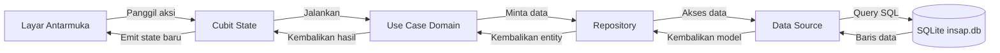
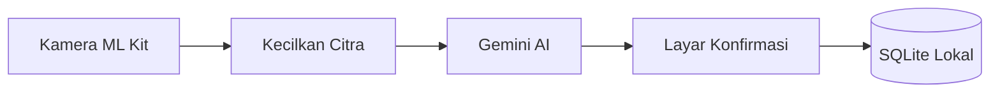

# Insap: Yuk Sadar Boncos

Aplikasi pencatat keuangan pribadi berbasis AI untuk mahasiswa.

## Tim Pengembang

| Nama | NIM | Peran |
|---|---|---|
| Rahmat Riyadi | 2409106074 | Project Manager, pemegang fondasi |
| Muh Ghazy Daffa Sampe | 2309106063 | Pemegang fitur |
| Luthfi Farros Athailah | 2309106073 | Pemegang fitur |

Mata kuliah Pemrograman Piranti Bergerak, Informatika, Universitas Mulawarman.

## Tentang Aplikasi

Insap adalah aplikasi pencatat keuangan pribadi yang dirancang khusus untuk mahasiswa dengan mengadaptasi metode refleksi Kakeibo. Insap berfokus pada pembentukan kebiasaan sadar finansial secara bertahap dan menempatkan pengguna sebagai pengendali utama keuangannya.

### Masalah yang Diselesaikan

1. Pengeluaran mahasiswa didominasi oleh transaksi bernominal kecil tetapi frekuensinya sering (jajan daring, transportasi, top up game, dan patungan kos) sehingga sulit diingat pada akhir bulan.
2. Proses pencatatan manual terasa merepotkan dan melelahkan, membuat kebiasaan mencatat sering terhenti hanya dalam beberapa hari.
3. Aplikasi keuangan yang tersedia di pasaran umumnya hanya berfokus pada rekapitulasi angka tanpa membantu mendorong perubahan perilaku nyata penggunanya.
4. Aplikasi sejenis kebanyakan berbahasa Inggris atau bernuansa korporat, tidak menggunakan kategori maupun gaya bahasa yang dekat dengan keseharian mahasiswa Indonesia.

### Sasaran Pengguna

- **Target utama:** Mahasiswa (rentang usia 18 sampai 25 tahun), baik mahasiswa yang menerima uang kiriman bulanan dari orang tua maupun mahasiswa indekos yang memiliki penghasilan tambahan dan mengelola pengeluaran bersama atau patungan.
- **Bukan target pengguna:** Pelaku usaha yang membutuhkan sistem akuntansi ganda atau perpajakan, karyawan yang memerlukan sistem penggantian biaya kantor (reimbursement), serta pengguna yang menginginkan integrasi otomatis dengan rekening perbankan.

## Cara Kerja Aplikasi

### Alur Pengguna

1. **Perkenalan (F-16):** Pengguna baru disambut tiga layar perkenalan tentang pencatatan ala Kakeibo dan filosofi sadar boncos, lalu diajak menetapkan target pengeluaran bulanan. Langkah target boleh dilewati dan diisi belakangan.
2. **Beranda (F-05):** Menampilkan pengeluaran pekan ini dibanding pekan lalu, tombol Catat Cepat dan Pindai Struk beserta sisa kuota pindai, serta kartu rincian pengeluaran per kategori yang dapat beralih antara pekan ini dan bulan ini. Pada tab bulan ini, total pengeluaran dibandingkan dengan target bulanan lengkap dengan bilah progres dan keterangan sisa atau lewat target. Target dapat diubah langsung lewat lembar bawah. Pada akhir pekan (hari Sabtu dan Minggu), Beranda menampilkan banner ritual refleksi mingguan. Pengguna yang belum punya data melihat tampilan Beranda kosong berisi ajakan mulai mencatat.
3. **Catat Transaksi Manual (F-01 & F-07):** Memasukkan nominal pengeluaran, memilih tanggal, dan memilih salah satu dari sembilan kategori mahasiswa. Untuk kategori opsional dan hiburan, aplikasi menanyakan pertimbangan niat belanja: "butuh atau pengen".
4. **Pindai Struk dengan AI (F-09 s.d. F-11):** Sebelum pemindai dibuka, aplikasi menampilkan popup dialog panduan pindai (dengan opsi centang "Jangan tampilkan lagi") serta memeriksa sisa kuota mingguan, ketersediaan koneksi internet, dan kelengkapan kunci API Gemini. Pengguna memindai struk fisik dari kamera atau galeri melalui ML Kit Document Scanner yang secara otomatis memotong dan meluruskan sudut dokumen. Citra struk diperkecil ke ukuran maksimal 1024 piksel untuk menghemat transmisi data, lalu dikirim ke Google Gemini untuk membaca nama toko, tanggal transaksi, serta rincian tiap barang belanjaan beserta harga dan usulan kategori. Aplikasi kemudian mengelompokkan barang belanjaan per kategori. Foto struk dikirim ke Google Gemini untuk dibaca dan tidak disimpan di penyimpanan Insap. Pengguna diberikan batas waktu tunggu hingga 90 detik dengan teks status yang berganti secara bertahap (detik 0-14 teks awal, detik 15-44 status pemrosesan struk panjang, dan detik 45 ke atas saran pembatalan bila respon terlalu lama). Hasil pembacaan Gemini disajikan di layar konfirmasi: pengguna dapat menghapus centang barang tertentu (misalnya titipan teman), menyunting harga, atau mengganti kategori. Saat tombol "Simpan semua" ditekan, aplikasi menyimpan satu transaksi per kategori ke basis data lokal. Kuota gratis diberikan sebanyak 10 kali pemindaian per pekan yang direset setiap hari Senin (untuk build khusus demo pameran tersedia kuota 200 pemindaian lewat flag kompilasi), dan kuota tidak dipotong saat pemindaian gagal.
5. **Riwayat Transaksi (F-02 & F-16):** Melihat seluruh catatan pengeluaran yang dikelompokkan per tanggal. Dilengkapi filter rentang tanggal dan kategori, halaman detail transaksi, tombol hapus transaksi dengan dialog konfirmasi, serta tampilan keadaan kosong yang informatif saat belum ada transaksi atau saringan tidak menemukan hasil.
6. **Refleksi Mingguan (F-08):** Ritual evaluasi keuangan akhir pekan berbasis metode Kakeibo untuk membangun kesadaran finansial (status selesai). Layar refleksi menyajikan kartu evaluasi pekan lalu, perbandingan total pengeluaran pekan ini versus pekan lalu, evaluasi target mingguan versus realisasi, rekapitulasi empat kelompok Kakeibo (esensial, opsional, hiburan, tak terduga), analisis porsi niat belanja "pengen", formulir isian kalimat perbaikan diri, serta penetapan target pekan depan. Setelah disimpan, formulir berubah menjadi kartu ringkasan refleksi yang dilengkapi tombol Ubah. Pengguna juga dapat meninjau riwayat refleksi sebelumnya melalui halaman riwayat refleksi sederhana (mode baca saja). Banner pengingat refleksi otomatis tampil di Beranda pada hari Sabtu dan Minggu. Fitur pengingat notifikasi mingguan ditunda.
7. **Akun & Cadangan Awan (F-17 & F-13):** Pengguna dapat masuk secara opsional dengan email dan kata sandi atau dengan akun Google (Firebase Auth). Setelah masuk, nama dan foto akun Google tampil di header Beranda dan halaman Akun. Mengetuk avatar di header langsung membuka halaman Akun & Cadangan. Data lokal (transaksi, kategori, refleksi mingguan) dapat dicadangkan secara manual ke Cloud Firestore. Fitur pemulihan data dari awan hanya diizinkan bila tabel transaksi DAN tabel refleksi_mingguan pada perangkat lokal dalam keadaan kosong, guna mencegah data baru di perangkat tertimpa. Pencadangan juga ditolak bila perangkat kosong sementara cadangan di awan sudah berisi data. Masuk akun bersifat opsional, seluruh fitur utama aplikasi tetap berfungsi penuh secara luring (KNF-04).
8. **Navigasi:** Bilah navigasi bawah berisi empat tab (Beranda, Catat, Refleksi, Riwayat) dengan header seragam di setiap tab berisi logo, nama layar, dan avatar akun.

### Arsitektur Aplikasi

Insap menerapkan arsitektur bersih (*Clean Architecture*) ringan dengan pendekatan *feature-first*. Kode aplikasi terbagi menjadi tiga lapisan utama:
- **Presentation:** Mengelola widget antarmuka dan status tampilan. Menggunakan `flutter_bloc` dengan pola Cubit agar perubahan state terprediksi dan mudah diuji tanpa boilerplate event.
- **Domain:** Lapisan inti logika bisnis yang independen dari kerangka kerja. Memuat *entity* data dan *use case* (misalnya `TambahTransaksi`, `AmbilRingkasanPekan`, `AmbilRincianKategori`, `AmbilRiwayat`, `HapusTransaksi`, `AmbilDetailTransaksi`, `SimpanRefleksi`, `PindaiStruk`, `AmbilKuotaPindai`).
- **Data:** Mengelola persistensi dan sumber data. Memuat *model* data, implementasi *repository*, *data source* lokal yang berinteraksi langsung dengan SQLite, serta *data source* jarak jauh (seperti pemanggilan API Gemini lewat `dio` dan layanan awan Firebase).

Dependensi antarkomponen dihubungkan menggunakan `get_it` sebagai penyedia layanan (*service locator*). Navigasi aplikasi diatur secara deklaratif menggunakan `go_router` dengan `StatefulShellRoute`, sehingga bilah navigasi bawah tetap mempertahankan state masing-masing tab saat pengguna berpindah menu.

### Alur Data

Diagram berikut menggambarkan alur data dari antarmuka pengguna hingga penyimpanan SQLite:



Alur pemindaian struk dengan kecerdasan buatan dirancang melalui alur pemrosesan citra dan validasi pengguna berikut:



## Cara Menghubungkan Database

### Konfigurasi Lokal Tanpa Server

Penyimpanan utama aplikasi Insap menggunakan basis data relasional SQLite lokal melalui pustaka `sqflite`. Seluruh catatan transaksi dan keuangan pengguna disimpan langsung di direktori privat perangkat tanpa memerlukan server basis data eksternal. Aplikasi dapat digunakan sepenuhnya secara luring (*offline*) tanpa memerlukan akun pengguna. Koneksi internet hanya digunakan untuk layanan kecerdasan buatan pemindai struk (Google Gemini API via REST) dan fitur pencadangan awan opsional (Firebase Auth & Cloud Firestore).

### Berkas dan Lokasi Basis Data

- **Nama berkas:** `insap.db`
- **Lokasi berkas:** Ditentukan otomatis oleh sistem operasi Android melalui `getDatabasesPath()`, biasanya berada di jalur direktori privat aplikasi `/data/user/0/com.riyadiambis.insap/databases/insap.db`.
- **Versi skema:** Versi 1 (sesuai konstanta `version: 1` pada `DatabaseHelper`).

### Inisialisasi Otomatis dan Seeding

Basis data dibuat secara otomatis saat aplikasi pertama kali dijalankan melalui kelas `DatabaseHelper`:
1. Dukungan integritas foreign key diaktifkan melalui perintah `PRAGMA foreign_keys = ON`.
2. Empat tabel dibuat sesuai acuan `docs/SCHEMA.sql`:
   - `kategori`: Menyimpan daftar kategori pengeluaran dan kelompok Kakeibo.
   - `transaksi`: Menyimpan catatan pengeluaran dengan nominal integer Rupiah penuh.
   - `refleksi_mingguan`: Menyimpan riwayat refleksi dan target mingguan.
   - `pengaturan`: Menyimpan pasangan kunci-nilai preferensi aplikasi.
3. Data awal (*seeding*) diisi otomatis satu kali: sembilan kategori bawaan mahasiswa (`seedKategori`) dan nilai awal preferensi aplikasi (`buatSeedPengaturan`).

### Kode yang Terlibat

- `lib/core/database/database_helper.dart`: Mengelola siklus hidup basis data SQLite secara singleton, mencakup pembuatan tabel, pengaktifan foreign key, dan penyemaian data awal.
- `lib/features/*/data/datasources/*_local_datasource.dart`: Menjalankan query SQL langsung ke tabel SQLite untuk operasi baca dan tulis data mentah.
- `lib/features/*/data/repositories/*_repository_impl.dart`: Menerapkan kontrak repository lapisan domain dengan memanggil data source dan mengonversi model basis data menjadi entity domain.

### Cara Melihat Isi Basis Data

Untuk memeriksa dan melihat isi tabel basis data secara langsung saat aplikasi berjalan:
1. Buka proyek ini di Android Studio.
2. Jalankan aplikasi pada emulator Android atau perangkat fisik dalam mode debug.
3. Buka jendela **App Inspection** melalui menu **View > Tool Windows > App Inspection**.
4. Pilih tab **Database Inspector**.
5. Pilih proses aplikasi `insap`. Seluruh tabel (`kategori`, `transaksi`, `refleksi_mingguan`, `pengaturan`) akan tampil dan datanya dapat diperiksa secara langsung (*live inspection*).

### Cara Mengulang Basis Data dari Awal

Jika ingin mereset basis data ke kondisi awal instalasi:
1. Buka menu **Pengaturan** (*Settings*) pada perangkat Android atau emulator.
2. Buka menu **Aplikasi** (*Apps*) > **Insap**.
3. Pilih **Penyimpanan & Cache** (*Storage & Cache*), lalu tekan **Hapus Penyimpanan** (*Clear Storage* / *Clear Data*).
4. Saat aplikasi dibuka kembali, `DatabaseHelper` akan membuat ulang berkas `insap.db` lengkap dengan tabel dan data awal.

### Alasan Memilih SQLite Lokal

Insap memilih SQLite lokal sebagai basis data utama agar data keuangan pengguna tersimpan seutuhnya di perangkat fisik pengguna tanpa risiko kebocoran privasi ke pihak ketiga (KNF-04), serta menjamin aplikasi tetap dapat digunakan kapan saja secara luring (*offline*) tanpa bergantung pada koneksi internet (KNF-01). Koneksi jaringan internet hanya dibutuhkan saat memindai struk dengan Google Gemini atau saat pengguna secara sengaja melakukan pencadangan awan ke Firebase.

## Fitur dan Status

Pengembangan aplikasi Insap dilakukan secara bertahap per versi sesuai dengan jadwal dan kriteria selesai pada dokumen ROADMAP.

### v0.1 Fondasi

| Kode | Nama Fitur | Keterangan singkat | Pemilik | Status |
|---|---|---|---|---|
| F-01 | Input transaksi manual | Form isian jumlah, kategori, tanggal, catatan singkat | Riyadi | selesai |
| F-02 | Riwayat transaksi | Daftar transaksi yang dapat disaring per tanggal dan kategori | Dafa | selesai |
| F-03 | Kategori khas mahasiswa | Sembilan kategori bawaan sudah berjalan, pengelolaan kategori ditunda | Luthfi | sebagian |
| F-04 | Penyimpanan lokal | Seluruh data tersimpan di perangkat menggunakan SQLite | Riyadi | selesai |
| F-05 | Ringkasan periodik | Total per kategori mingguan dan bulanan, plus perbandingan total bulan dengan target bulanan | Riyadi | selesai |
| F-06 | Format Rupiah | Penulisan mata uang yang benar, misalnya Rp15.000 | Riyadi | selesai |
| F-07 | Tanya niat belanja | Pertanyaan "butuh atau pengen" untuk kategori opsional dan hiburan | Riyadi | selesai |
| F-16 | Perkenalan dan keadaan kosong | Tiga layar perkenalan, target bulanan, serta tampilan keadaan kosong di Beranda, Riwayat, dan Riwayat Refleksi | Riyadi, Dafa, Luthfi | selesai |

### v0.2 Pembeda

| Kode | Nama Fitur | Keterangan singkat | Pemilik | Status |
|---|---|---|---|---|
| F-08 | Refleksi mingguan | Ritual akhir pekan: kartu pekan lalu, 4 kelompok Kakeibo, porsi pengen, catatan perbaikan, target pekan depan, ringkasan, dan riwayat refleksi | Dafa (awalnya Luthfi) | selesai |

### v0.3 Kecerdasan

| Kode | Nama Fitur | Keterangan singkat | Pemilik | Status |
|---|---|---|---|---|
| F-09 | Pindai struk | Foto struk dipotong otomatis dengan ML Kit Document Scanner, diperkecil, lalu dibaca Gemini AI | Dafa | selesai |
| F-10 | Konfirmasi hasil pindai | Hasil pembacaan AI disajikan sebagai draf interaktif (hapus centang, sunting harga, ganti kategori) sebelum disimpan | Dafa | selesai |
| F-11 | Kuota pindai gratis | Sepuluh pemindaian per pekan, direset setiap Senin, tidak dipotong saat gagal, dan opsi kuota demo pameran | Dafa | selesai |

### v0.4 Pemantapan

| Kode | Nama Fitur | Keterangan singkat | Pemilik | Status |
|---|---|---|---|---|
| F-14 | Ekspor laporan | Unduh rekap bulanan dalam bentuk berkas PDF | - | belum dimulai |

### v1.0 Rilis

| Kode | Nama Fitur | Keterangan singkat | Pemilik | Status |
|---|---|---|---|---|
| F-12 | Laporan AI bulanan | Ringkasan naratif berbahasa santai tentang pola belanja sebulan | - | belum dimulai |

### Fitur Akun, Cadangan, dan Premium

Fitur masuk akun dan cadangan awan dikerjakan lebih awal dari urutan versi untuk menerapkan materi Modul 06 (Firebase), menggunakan Firebase Auth dan Cloud Firestore. Fitur langganan premium dan pindai tanpa batas tetap direncanakan untuk tahap berikutnya.

| Kode | Nama Fitur | Keterangan singkat | Pemilik | Status |
|---|---|---|---|---|
| F-17 | Masuk dengan akun (Email & Google) | Firebase Auth, menampilkan nama dan foto akun Google di Beranda dan halaman Akun | Riyadi | selesai |
| F-13 | Cadangan awan | Cadangkan dan pulihkan manual ke Cloud Firestore, pemulihan hanya di perangkat kosong | Riyadi | selesai |
| F-18 | Langganan premium | Penagihan lewat Google Play Billing, bergantung pada F-17 | - | belum dimulai |
| F-15 | Pindai tanpa batas | Menghapus kuota mingguan bagi pelanggan, bergantung pada F-18 | - | belum dimulai |

## Teknologi

Aplikasi ini dibangun menggunakan tumpukan teknologi berikut:

- **Kerangka Kerja:** Flutter (Dart SDK `^3.13.1`)
- **Arsitektur:** Clean Architecture dengan pendekatan *feature-first*
- **Manajemen State:** `flutter_bloc` (`^9.1.1`) menggunakan pola Cubit
- **Injeksi Dependensi:** `get_it` (`^9.3.0`) sebagai penyedia layanan (*service locator*)
- **Navigasi:** `go_router` (`^18.0.1`) dengan dukungan `StatefulShellRoute`
- **Basis Data Lokal:** SQLite melalui pustaka `sqflite` (`^2.4.4`) dan `path` (`^1.9.1`)
- **Jaringan & Layanan AI:**
  - `dio` (`^5.11.1`) sebagai klien HTTP REST API
  - Google Gemini API: REST API v1beta dengan model bawaan `gemini-3.5-flash-lite` (didefinisikan di `lib/core/network/gemini_client.dart`)
  - `google_mlkit_document_scanner` (`^0.6.1`) untuk deteksi dan pemindaian dokumen fisik via kamera atau galeri
- **Layanan Awan & Autentikasi:**
  - `firebase_core` (`^3.12.1`)
  - `firebase_auth` (`^5.5.1`)
  - `cloud_firestore` (`^5.6.5`)
  - `google_sign_in` (`^6.3.0`)
- **Pustaka Pendukung & Aset:**
  - `equatable` (`^3.0.0`) untuk perbandingan objek state
  - `cupertino_icons` (`^1.0.8`)
  - Tipografi lokal: font Baloo 2 dan Nunito yang dimuat langsung dari aset aplikasi

## Cara Menjalankan

> **CATATAN PENTING: Aplikasi HANYA jalan di Android (emulator atau HP fisik). Chrome, Edge, dan Windows tidak didukung karena sqflite tidak berjalan di sana.**

Berkas APK aplikasi dikumpulkan lewat Google Drive tugas kelas sesuai ketentuan pengumpulan mata kuliah.

Ikuti langkah-langkah berikut untuk menjalankan atau mengompilasi aplikasi:

1. Unduh seluruh dependensi proyek:
   ```bash
   flutter pub get
   ```
2. Konfigurasi Kunci API Gemini:
   Salin berkas contoh `.env.example` menjadi `.env`:
   ```bash
   copy .env.example .env
   ```
   Buka berkas `.env` dan isi variabel `GEMINI_API_KEY` dengan kunci API milik Anda dari Google AI Studio.
   *Catatan:* Bila aplikasi dijalankan tanpa berkas `.env`, seluruh fitur manual dan lokal tetap berfungsi normal, namun fitur pemindai struk akan memunculkan pesan "Pindai struk belum aktif di versi ini" ketika dibuka.
3. Nyalakan emulator Android melalui Android Studio, atau hubungkan HP Android ke komputer dengan mengaktifkan mode *USB Debugging*.
4. Periksa perangkat yang terhubung dan catat ID perangkat target:
   ```bash
   flutter devices
   ```
5. Jalankan aplikasi ke perangkat Android yang dipilih:
   ```bash
   flutter run --dart-define-from-file=.env -d <id-perangkat>
   ```
6. Membangun Berkas APK:
   Untuk mengompilasi berkas APK rilis:
   ```bash
   flutter build apk --release --dart-define-from-file=.env
   ```
   Hasil keluaran berkas APK berada di lokasi:
   `build\app\outputs\flutter-apk\app-release.apk`

   *Catatan Build Demo Pameran:* Flag `KUOTA_PINDAI_PEKANAN` hanya digunakan khusus untuk build demo pameran (misalnya memberikan 200 pemindaian):
   ```bash
   flutter build apk --release --dart-define-from-file=.env --dart-define=KUOTA_PINDAI_PEKANAN=200
   ```
   Pada build biasa, kuota otomatis bernilai bawaan 10 per pekan tanpa perlu menambahkan flag tersebut.

## Struktur Folder

Struktur folder utama di dalam direktori `lib/` disusun sebagai berikut:

- `lib/core/`: Fondasi aplikasi lintas fitur yang mencakup tema, basis data lokal, jaringan, konstanta, navigasi, injeksi dependensi, utilitas, dan widget global.
  - `lib/core/bloc/`: Pengamat (*observer*) global untuk memantau perubahan state Cubit.
  - `lib/core/constants/`: Konstanta aplikasi seperti batasan kuota pemindaian struk per pekan (`kuota_constants.dart`).
  - `lib/core/database/`: Pengelola SQLite (DatabaseHelper), model tabel, dan data awal (*seeding*).
  - `lib/core/di/`: Konfigurasi pendaftaran injeksi dependensi menggunakan get_it.
  - `lib/core/network/`: Klien jaringan REST API (`GeminiClient`) berbasis dio untuk pemanggilan Gemini API.
  - `lib/core/router/`: Konfigurasi rute navigasi dan tata letak utama (AppShell) menggunakan go_router.
  - `lib/core/utils/`: Fungsi pembantu umum seperti ekstensi format mata uang Rupiah dan penanggalan pekan ISO.
  - `lib/core/widgets/`: Komponen antarmuka yang dapat digunakan bersama di berbagai fitur.
- `lib/features/`: Modul fungsionalitas aplikasi yang masing-masing dipisahkan per fitur.
  - `lib/features/beranda/`: Antarmuka layar utama serta Cubit ringkasan pengeluaran mingguan dan status kuota.
  - `lib/features/transaksi/`: Lapisan data, domain (use case), dan presentasi untuk form catat transaksi serta riwayat transaksi.
  - `lib/features/kategori/`: Lapisan data, domain, dan presentasi untuk pengelolaan kategori pengeluaran.
  - `lib/features/perkenalan/`: Antarmuka alur perkenalan awal (*onboarding*) untuk pengguna baru.
  - `lib/features/refleksi/`: Lapisan data, domain, dan presentasi untuk evaluasi pengeluaran mingguan berbasis metode Kakeibo dan riwayat refleksi.
  - `lib/features/pindai/`: Lapisan data, domain, dan presentasi untuk pemindaian struk fisik dengan ML Kit, integrasi AI Gemini, serta konfirmasi draf transaksi.
  - `lib/features/akun/`: Lapisan data, domain, dan presentasi untuk autentikasi akun Firebase Auth dan pencadangan awan Cloud Firestore (F-17 & F-13).
  - `lib/features/pengaturan/`: Pengaturan preferensi aplikasi dan pengelolaan status data perangkat.

## Cara Menghubungkan Firebase (Auth & Cloud Firestore)

Insap mendukung fitur autentikasi akun (F-17) dan pencadangan awan (F-13) menggunakan Firebase Auth dan Cloud Firestore. Pengguna dapat mencadangkan transaksi, kategori, dan refleksi lokal ke awan, serta memulihkannya kembali secara transaksional.

### 1. Prasyarat Alat
Pastikan Firebase CLI dan FlutterFire CLI terpasang dan terautentikasi di lingkungan pengembangan:
```bash
npm install -g firebase-tools
firebase login
dart pub global activate flutterfire_cli
```

### 2. Konfigurasi Proyek Firebase
Jalankan FlutterFire CLI untuk mengonfigurasi platform Android:
```bash
flutterfire configure --project=insap-riyadiambis --platforms=android --android-package-name=com.riyadiambis.insap -y
```
Perintah ini akan memperbarui `android/app/google-services.json` dan menghasilkan konfigurasi bootstrap di `lib/firebase_options.dart`.

### 3. Pendaftaran SHA-1 untuk Google Sign-In
Untuk mengaktifkan autentikasi Google Sign-In di perangkat Android atau emulator:
1. Ambil sidik jari sertifikat SHA-1 debug:
   ```bash
   cd android
   ./gradlew signingReport
   ```
2. Daftarkan fingerprint SHA-1 ke Firebase Console atau melalui CLI:
   ```bash
   firebase apps:android:sha:create 1:462432178922:android:835d03946af004e1ecfd93 <FINGERPRINT-SHA-1> --project=insap-riyadiambis
   ```
3. Unduh ulang konfigurasi terbaru dengan menjalankan kembali `flutterfire configure`.

### 4. Aturan Keamanan Cloud Firestore
Aturan keamanan Firestore (`firestore.rules`) mengisolasi seluruh data pengguna sehingga hanya dapat diakses oleh pemilik dokumen yang sah (`request.auth.uid == uid`). Publikasikan aturan keamanan via CLI:
```bash
firebase deploy --only firestore:rules --project=insap-riyadiambis
```

## Penerapan Materi Praktikum

Aplikasi Insap menerapkan seluruh materi praktikum Pemrograman Piranti Bergerak secara menyeluruh sebagai berikut:

| Modul | Contoh Penerapan | Keterangan Singkat |
|---|---|---|
| Modul 01 Dasar Dart | `lib/core/utils/rupiah_extension.dart`, `lib/features/transaksi/domain/entities/transaksi_entity.dart` | Penggunaan extension method, named parameter, constructor bernilai const, null safety, dan perbandingan objek Equatable. |
| Modul 02 Widget dan tata letak | `lib/core/widgets/header_aplikasi.dart`, `lib/features/beranda/presentation/widgets/kartu_rincian_pengeluaran.dart` | Pemanfaatan komponen tata letak hierarkis: Container, SafeArea, Column, Row, Expanded, Stack, Wrap, dan dekorasi bayangan solid. |
| Modul 03 Interaksi/formulir/navigasi | `lib/features/transaksi/presentation/catat/pages/halaman_catat_transaksi.dart`, `lib/core/router/app_router.dart` | Penggunaan Form dengan GlobalKey, validasi input TextFormField, pengelolaan fokus keyboard, dialog konfirmasi, serta navigasi deklaratif go_router dengan StatefulShellRoute. |
| Modul 04 Manajemen state | `lib/features/beranda/presentation/cubit/beranda_cubit.dart`, `lib/features/transaksi/presentation/riwayat/cubit/riwayat_cubit.dart` | Pengelolaan status aplikasi menggunakan flutter_bloc (Cubit), emisi state immutable, serta konsumsi state melalui BlocBuilder, BlocListener, dan BlocConsumer. |
| Modul 05 sqflite | `lib/core/database/database_helper.dart`, `lib/features/transaksi/data/datasources/transaksi_local_datasource.dart` | Pengelolaan basis data relasional lokal SQLite, pembuatan tabel relasional, foreign keys, seeding data awal, dan operasi query CRUD langsung. |
| Modul 06 Firebase | `lib/features/akun/data/datasources/autentikasi_remote_datasource.dart`, `lib/features/akun/data/datasources/cadangan_remote_datasource.dart` | Autentikasi surel dan Google Sign-In via Firebase Auth, serta pencadangan dan pemulihan data transaksional ke Cloud Firestore. |
| Modul 07 REST dan JSON | `lib/core/network/gemini_client.dart`, `lib/features/pindai/data/datasources/pindai_remote_datasource.dart` | Komunikasi jaringan HTTP REST API dengan Dio, pengiriman payload ke endpoint Google Gemini v1beta, dan serialisasi data JSON model. |
| Modul 08 Fitur perangkat | `lib/features/pindai/presentation/pages/halaman_pindai.dart`, `lib/features/pindai/presentation/utils/gambar_helper.dart` | Pemanfaatan kamera fisik dan galeri dokumen menggunakan Google ML Kit Document Scanner serta manipulasi ukuran citra menggunakan pustaka kanvas perangkat dart:ui. |

## Alur Kerja Tim

Sesuai aturan di `ATURAN-GIT.md`:

- **Satu branch per ISSUE:** Setiap pekerjaan dikerjakan pada branch terpisah dengan format `feat/` untuk fitur baru, `fix/` untuk perbaikan bug, `chore/` untuk tugas pemeliharaan atau build, dan `docs/` untuk dokumentasi (misalnya `feat/issue-XX-nama-fitur` atau `fix/issue-XX-nama-perbaikan`).
- **Dilarang push langsung ke main:** Semua anggota tim dilarang melakukan push langsung ke branch `main`.
- **Wajib melalui Pull Request:** Integrasi kode ke branch `main` hanya dapat dilakukan melalui Pull Request yang telah ditinjau oleh Project Manager (Rahmat Riyadi).
- **Kerapian kode dan uji otomatis:** Sebelum membuka Pull Request, pengembang wajib memastikan perintah `flutter analyze` dan `flutter test` berjalan bersih tanpa galat.
- **Peta kepemilikan berkas:** Setiap pengembang hanya boleh mengubah berkas yang menjadi tanggung jawabnya sesuai tabel kepemilikan berkas guna menghindari konflik Git.

## Dokumen Perencanaan

Dokumen perencanaan teknis dan produk (PRD, ROADMAP, dan berkas ISSUE) dikelola pada repositori terpisah bernama `insap-docs` yang dapat diakses pada tautan berikut:

- Repositori Dokumen: [https://github.com/riyadiambis/insap-docs.git](https://github.com/riyadiambis/insap-docs.git)

Di lingkungan lokal pengembang, repositori tersebut di-clone ke dalam direktori `docs/` dan secara otomatis diabaikan oleh `.gitignore` pada repositori kode aplikasi.
