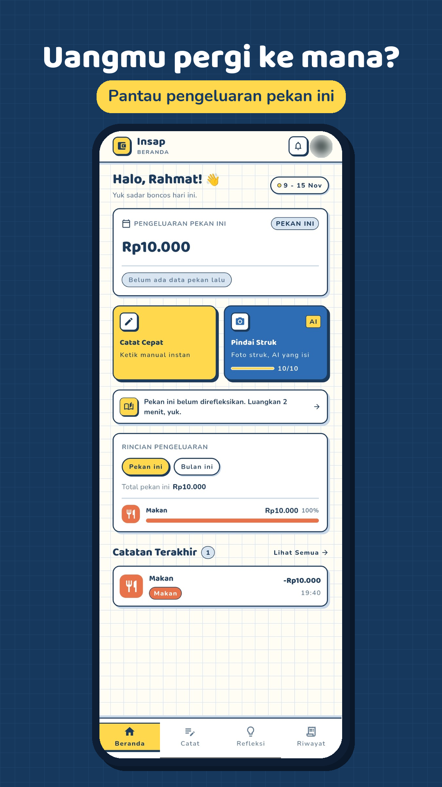
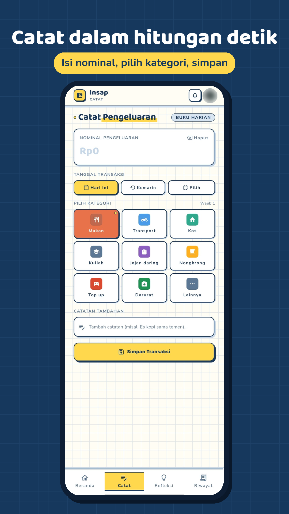
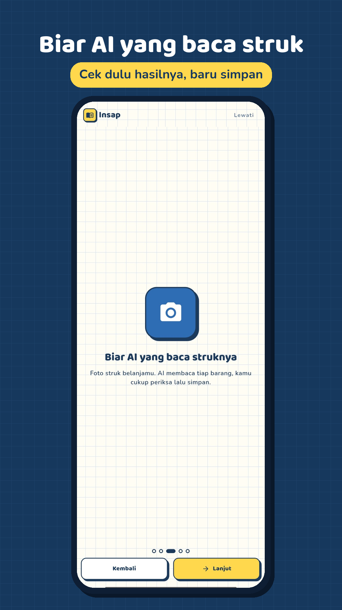
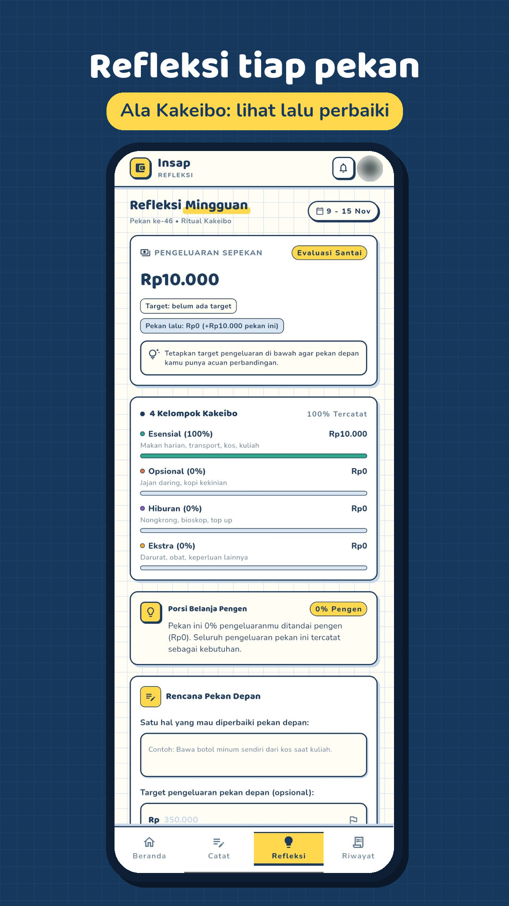
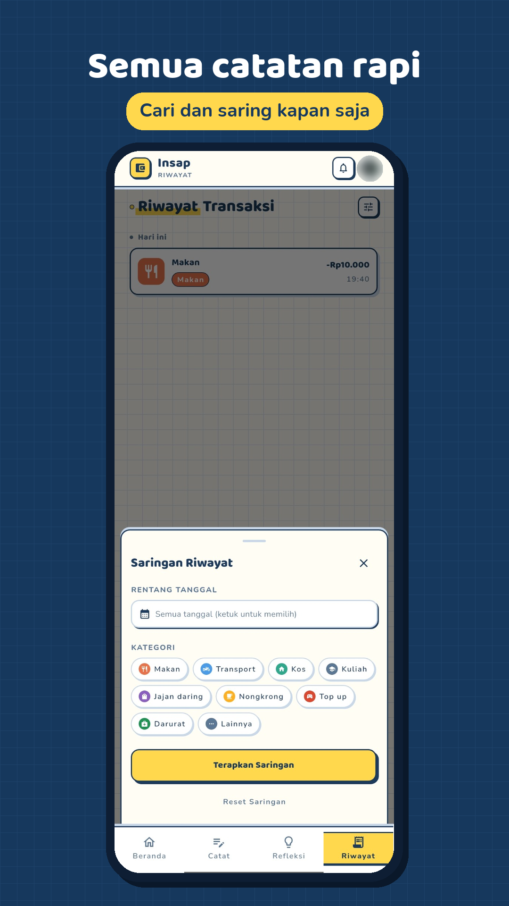
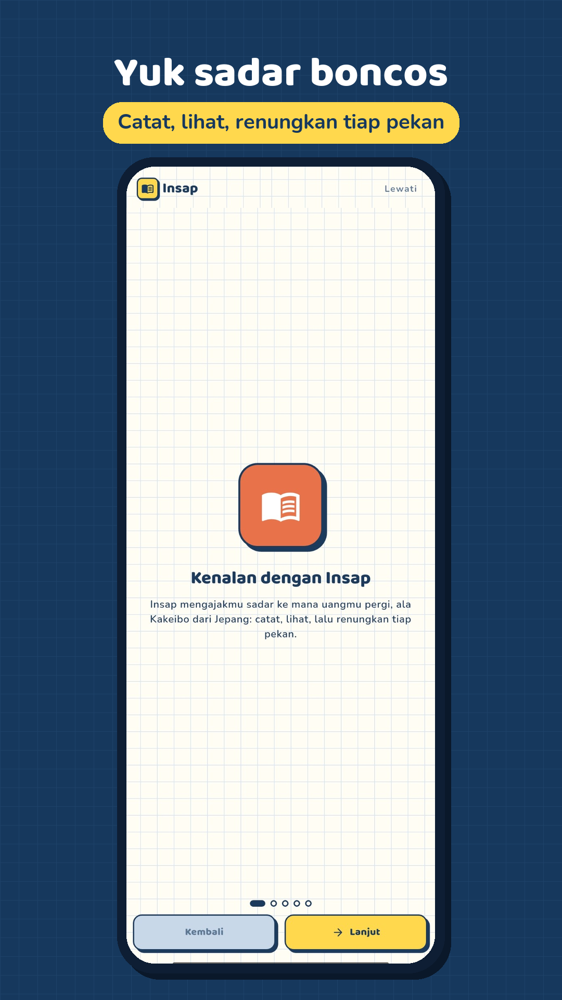

# Insap: Yuk Sadar Boncos

Aplikasi Android pencatat pengeluaran untuk mahasiswa. Catat transaksi dalam hitungan detik, pindai struk belanja dengan AI, lalu luangkan dua menit tiap akhir pekan untuk refleksi ala Kakeibo bersama Struki, maskot Insap.

Dikembangkan oleh **Ofisharu Labs**.

> Segera hadir di Google Play.

<p align="center">
  
  
  
</p>
<p align="center">
  
  
  
</p>

## Kenapa Insap

Pengeluaran mahasiswa kebanyakan bernominal kecil tapi sering: jajan daring, ongkos ojek, top up, patungan kos. Satu-satu terasa ringan, tapi di akhir bulan sulit diingat ke mana uangnya pergi. Insap membantu mencatat tanpa repot dan, yang lebih penting, mengajak melihat lagi kebiasaan belanja tiap pekan supaya perlahan berubah.

## Fitur utama (versi 2.x)

- **Catat cepat.** Nominal, tanggal, dan sembilan kategori khas mahasiswa (makan, kos, transportasi, kuliah, jajan daring, nongkrong, dan lainnya). Untuk belanja opsional dan hiburan, Insap bertanya: butuh atau pengen?
- **Pindai struk dengan AI.** Foto struk dibaca oleh Google Gemini menjadi daftar barang, harga, dan usulan kategori. Hasilnya bisa diperiksa dan disunting sebelum disimpan. Ada kuota pindai gratis mingguan, dan kuota tambahan bisa didapat lewat iklan berhadiah yang sepenuhnya opsional.
- **Refleksi mingguan ala Kakeibo.** Bandingkan pengeluaran pekan ini dengan pekan lalu, lihat porsi empat kelompok Kakeibo (esensial, opsional, hiburan, ekstra), lalu tulis satu hal yang mau diperbaiki pekan depan.
- **Beranda dan target bulanan.** Ringkasan pekan ini, rincian per kategori, dan progres terhadap target bulanan.
- **Riwayat.** Semua catatan dikelompokkan per tanggal dengan filter rentang dan kategori.
- **Struki.** Maskot yang menemani perkenalan, petunjuk, dan keadaan kosong.
- **Data tetap di ponsel.** Semua data tersimpan lokal di SQLite dan aplikasi bisa dipakai luring. Cadangan awan lewat akun Google bersifat opsional, dan akun beserta cadangannya bisa dihapus kapan saja dari aplikasi.

## Teknologi

| Bagian | Pustaka |
|---|---|
| Kerangka | Flutter (Dart), Android |
| Manajemen state | `flutter_bloc` (Cubit) |
| Injeksi dependensi | `get_it` |
| Navigasi | `go_router` |
| Basis data lokal | `sqflite` |
| Akun dan cadangan | Firebase Auth, Cloud Firestore, Google Sign-In |
| Pindai struk | Google ML Kit Document Scanner, Google Gemini API (REST lewat `dio`) |
| Iklan berhadiah | Google Mobile Ads (AdMob) dengan UMP |

## Menjalankan secara lokal

Prasyarat: Flutter stable terbaru (Dart SDK 3.13 ke atas) dan Android SDK.

```bash
git clone https://github.com/riyadiambis/Insap-App-Flutter.git
cd Insap-App-Flutter
flutter pub get
cp .env.example .env    # isi GEMINI_API_KEY dengan kunci dari Google AI Studio
flutter run --dart-define-from-file=.env
```

Tanpa `GEMINI_API_KEY`, aplikasi tetap berjalan tetapi fitur pindai struk nonaktif.

Pemeriksaan kode dan pengujian:

```bash
flutter analyze
flutter test
```

Build rilis memerlukan berkas `android/key.properties` dan keystore milik sendiri (lihat `android/key.properties.example`). Keduanya tidak pernah di-commit.

## Struktur folder

```
lib/
  core/        komponen bersama: basis data, DI, router, tema, jaringan, iklan, widget
  features/    satu folder per fitur (beranda, transaksi, pindai, refleksi, akun, ...)
               masing-masing berlapis data, domain, presentation
  main.dart
test/          uji unit dan widget, mengikuti struktur lib/
android/       proyek Android
assets/        logo, maskot, dan font
```

## Privasi

Kebijakan privasi: <https://riyadiambis.github.io/insap-kebijakan/>

## Kontribusi dan keamanan

- Panduan kontribusi: [CONTRIBUTING.md](CONTRIBUTING.md)
- Melaporkan celah keamanan: [SECURITY.md](SECURITY.md)

## Lisensi

Hak cipta (c) 2026 Ofisharu Labs. Seluruh hak dilindungi. Kode ini dapat dilihat publik, tetapi tidak boleh disalin, diubah, atau didistribusikan tanpa izin tertulis. Lihat [LICENSE](LICENSE).

## Kontak

Ofisharu Labs: rahmatriyadiambis@gmail.com
